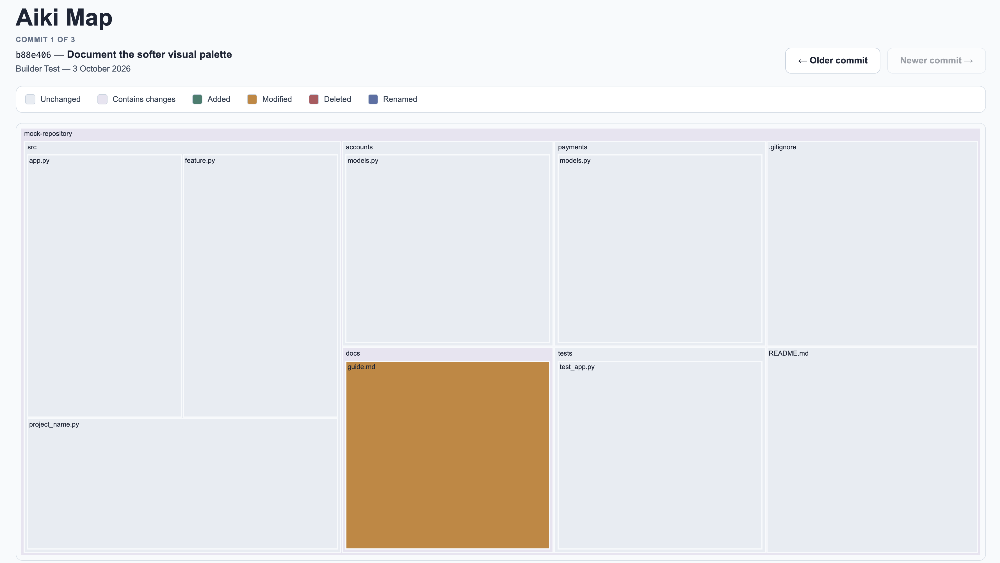

# Aiki Map

See what changed in your AI-assisted coding workflow—at a glance.

AI coding tools can modify more of a repository than you expected. Aiki Map turns
your current working changes and recent Git commits into an interactive visual
map, making it easier to spot which files changed and where they sit in the
project before you continue building.



## What the map shows

- Each rectangle represents a tracked file.
- Folder size reflects the number of files it contains—not lines of code or complexity.
- Working Changes opens first and includes staged, unstaged, and untracked files.
- Changed folders are highlighted so you can locate affected areas quickly.
- Commit History lets you inspect up to 10 recent commits.
- Selecting a file turns its box into an inspector showing exact state and line
  totals; Show Diff loads its read-only patch inside that box on demand.

| Colour | Meaning |
| --- | --- |
| Cool grey | Unchanged |
| Pale lavender | Folder contains changes |
| Muted teal | Added |
| Amber | Modified |
| Coral | Deleted |
| Indigo | Renamed |

## Install locally

You need Python 3.10 or newer and Git on your command line.

```bash
git clone https://github.com/anielhub-guru/aiki-map.git
uv tool install /path/to/aiki-map
```

This installs from the downloaded folder. It does not use or publish to PyPI. If
you prefer `pipx`, use `pipx install /path/to/aiki-map`.

When the local checkout changes, update the installed command with:

```bash
uv tool install --force /path/to/aiki-map
```

## Launch with an AI coding agent

Enter the repository the agent will modify and run one command:

```bash
cd /path/to/project
aikimap codex
```

For Claude Code:

```bash
aikimap claude
```

Arguments after the shortcut are passed to the agent:

```bash
aikimap codex --model your-model
```

AikiMap detects the current Git repository, records the baseline, opens the
corner window, and then starts the agent. The installed AikiMap process remains
active while the live map and wrapped agent are running.

For another terminal agent:

```bash
aikimap agent --source custom -- your-agent-command --its-argument
```

To inspect a repository without launching an agent:

```bash
aikimap view /path/to/repository
```

AikiMap starts a local server and opens the view. Working changes refresh every
2.5 seconds, and the interface redraws only when visual state changes.

To start the server without opening a browser automatically:

```bash
aikimap view /path/to/repository --no-open
```

To generate the original standalone file instead of running live mode:

```bash
aikimap view /path/to/repository --static
```

Use `--repository /path/to/repository` when launching outside the worktree. Use
`--browser` for remote, headless, or dependency-limited environments:

```bash
aikimap agent --source codex --repository /path/to/repository --browser -- codex
```

The native window uses the operating system webview on macOS, Windows, and Linux.
Linux systems may need their distribution's WebKitGTK runtime. If the native
webview cannot start, AikiMap falls back to the default browser and prints the
local review URL.

The wrapper is intended for terminal agents whose process remains active for the
work session. GUI editors that immediately detach require a future editor hook to
provide an accurate stop event.

## Read-only by design

Aiki Map observes the working tree and committed Git history without modifying the
repository it inspects. It does not stage files, create commits, switch branches,
restore files, or change Git configuration. Live mode binds only to `127.0.0.1`,
so repository data remains on the local computer.

## How it works

1. Read the current staged, unstaged, and untracked file states.
2. Read and cache metadata for the latest 10 commits.
3. Build the repository hierarchy from tracked files and current additions.
4. Check the working state every 2.5 seconds through a local endpoint.
5. Return no map data when the visual state is unchanged.
6. Redraw the working map when added, modified, deleted, or renamed paths change.
7. Read one validated file diff only when Show Diff is selected.
8. Optionally wrap an agent process and expose its session state locally.

Common dependency, build, cache, and editor directories are filtered from the map
so that application structure remains visible.

## Current scope

The current MVP combines all working changes in one map and keeps committed
history as a secondary view. It does not animate treemap geometry, show
side-by-side comparisons, edit files, or connect a change to the AI instruction
that caused it.
